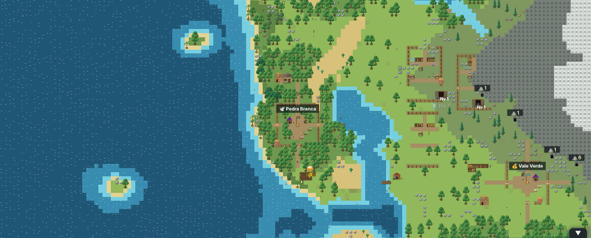
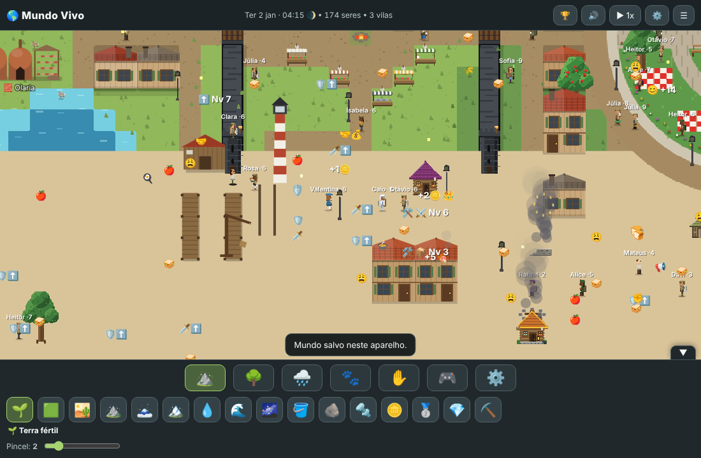
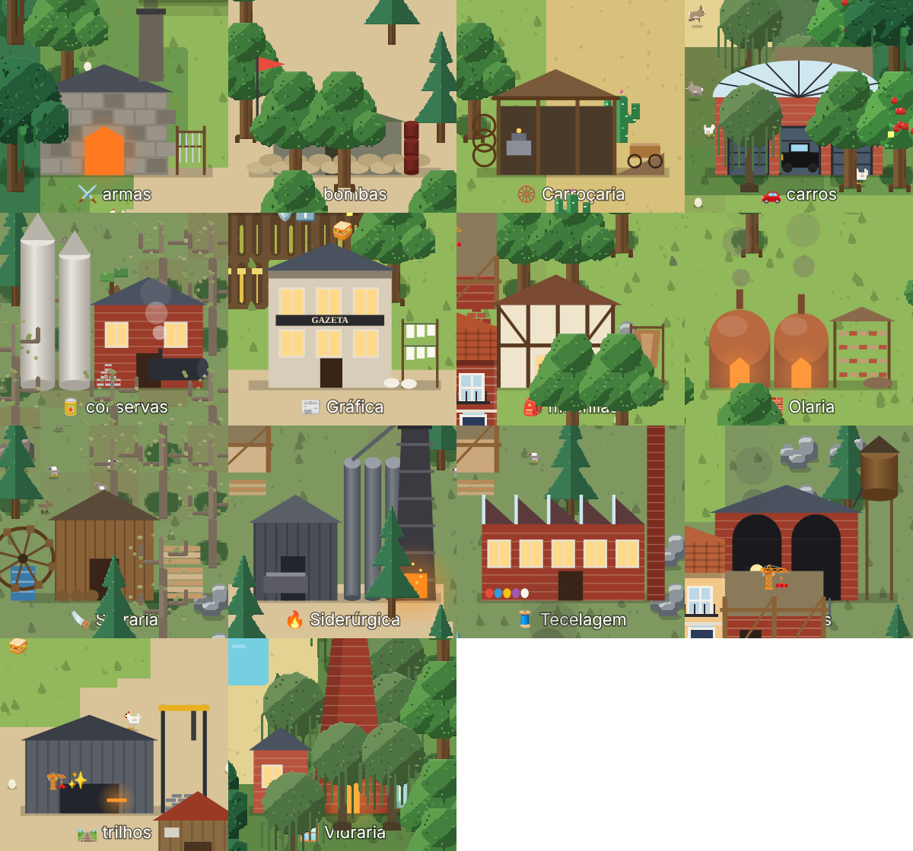
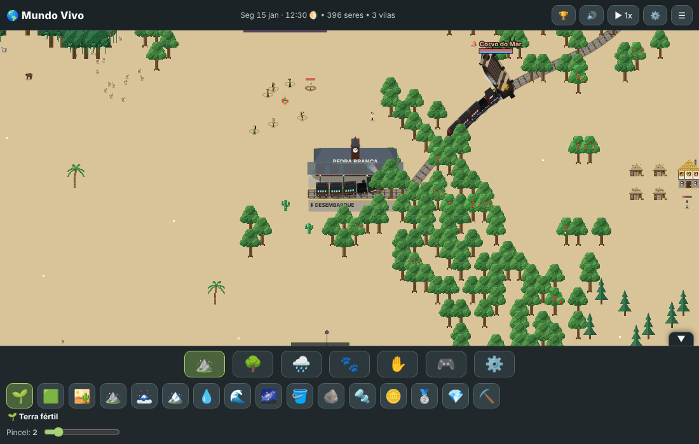
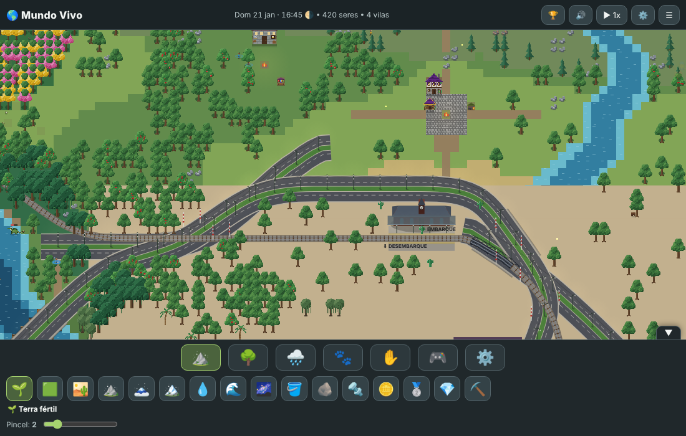
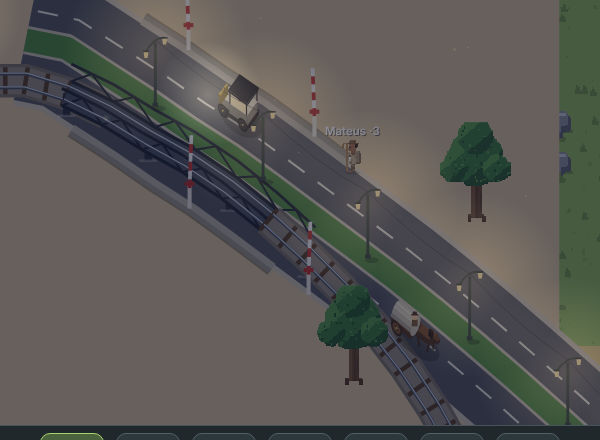
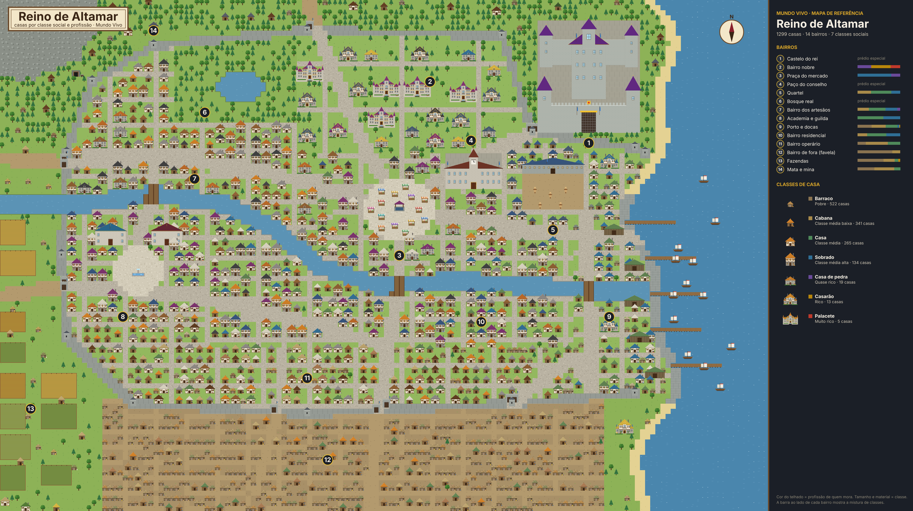

# 🌎 Mundo Vivo

**Um simulador de mundo vivo, em pixel art, que roda no navegador e no celular.**
Você molda o terreno e a vida acontece sozinha: bichos nascem, envelhecem e caçam; as pessoas formam casais, erguem vilas, viram reinos, fazem guerra, revolução, eleição e revolução industrial. Quando quiser, você entra na pele de qualquer um deles.

### ▶ [Jogar agora no navegador](https://tannya1977tavares-cyber.github.io/Mundo-vivo/jogar/) · 📱 [Baixar o APK (Android)](apk/MundoVivo-v37.apk) · 🌐 [Página do portfólio](https://tannya1977tavares-cyber.github.io/Mundo-vivo/)



---

## Sobre o jogo

- **Gênero:** simulação / sandbox / "god game" com controle de personagem
- **Plataformas:** navegador (computador ou celular) e Android 7+ (APK)
- **Tecnologia:** um único arquivo HTML com JavaScript puro e Canvas, sem servidor e sem internet. O app Android é um WebView em tela cheia.
- **Idioma:** português
- **Versão atual:** v37 (1º de novembro de 2026)
- **Autor:** Bruno, com desenvolvimento assistido por IA (Claude)

## Como jogar

| Ação | Celular | Teclado |
|---|---|---|
| Andar | joystick | WASD / setas |
| Ataques | botões 1, 2, 3 | `1` `2` `3` |
| Dash / pulo / pulo+dash | botões | `Q` / `C` / `X` |
| Bloquear / esquivar | segurar / tocar 🛡️ | `V` |
| Trocar elemento | coluna 💧⛰️🌀🔥 | `Z` |
| Poção de vida | barra ❤️💙💛 | `H` |

No **modo deus** você usa pincéis de terreno, natureza, chuva e animais. No **🎮 modo jogador** você cria seu próprio personagem (ou controla qualquer NPC) e pode virar **semideus** com os 4 elementos. O painel **⚙️** liga e desliga cada mecanismo do mundo.

## Os sistemas do mundo

| Área | O que tem |
|---|---|
| 🗺️ **Mapas** | IA cartógrafa que gera vários mapas e escolhe o melhor; 7 modelos (Costa recortada, Arquipélago, Mar interior, Duas margens...); até 240 × 180 |
| 🌳 **Natureza** | biomas brasileiros (Mata Atlântica, Caatinga, Cerrado, Pantanal) com cadeia alimentar: herbívoro, espalhador de sementes e predador; extinção; chuva que rega |
| 🐉 **Criaturas** | dragões com toca e ovos, lobisomens na lua cheia, monstros de caverna e chefes |
| 👪 **Gente** | necessidades, família (uma casa por casal), sonhos, personalidade (ganancioso/manso, corajoso, preguiçoso, honesto, trabalhador), XP e nível de ofício, velhice, herança |
| 🧬 **Evolução** | 100 sessões de simulação: os melhores de cada ofício passam os "genes" para a geração seguinte (v33) |
| 💰 **Economia** | livre mercado: quem produz vende na praça; preço por oferta e procura; 3 impostos do rei; salário só para empregados; você compra e anuncia no 🛒 Mercado |
| 🏘️ **Cidades** | barraco → cabana → casa → sobrado → casarão; reformas de tijolo e vitoriana; sobrados geminados em ruas; praças, postes, bairros, circo |
| 👕 **Roupas e avatar** | 3 conjuntos por profissão e classe social; editor de personagem |
| ⚔️ **Combate** | guildas elementais (Água, Terra, Ar, Fogo), 24 habilidades, máquina de estados de golpes, duelos de espada, guerras entre reinos |
| 🏛️ **Política** | reinos, conquista, revolta, revolução, decapitação do rei, capitalismo ou socialismo, democracia com eleição, parlamento, impeachment e corrupção |
| ⛪ **Religião** | calendário de cultos, altares e sacrifícios, sacerdotes |
| ⛵ **Mar** | portos, estaleiros, navios, tripulação, andar no convés, piloto automático, combate naval com poderes |
| 🕳️ **Cavernas** | exploração, monstros, chefes e tesouros |
| 🏭 **Revolução industrial** | minas por nível, 14 fábricas (siderúrgica, tecelagem, olaria, vidraria, gráfica com jornal...), 13 itens novos |
| 🚂 **Transporte** | ferrovias com traçado inteligente, pontes e túneis, estações com relógio, trens de passageiros, frete e tropas, avenidas, carros e carroças |

## Galeria

| | |
|---|---|
|  |  |
|  |  |
|  |  |

## Histórico de versões

| Versão | Destaque | Relatório |
|---|---|---|
| v37 | Uma casa por casal, cidades densas com sobrados, 8 fábricas e 13 itens novos | [ler](relatorios/v37-relatorio.md) |
| v36 | Sistema de transporte: trilhos inteligentes, estações, trens, avenidas e carros | [ler](relatorios/v36-relatorio.md) |
| v35 | Correção de bugs e primeira versão Android | [ler](relatorios/v35-relatorio.md) |
| v34 | Revolução industrial: casas de tijolo, minas, fábricas, ferrovia, inventário | [ler](relatorios/v34-relatorio.md) |
| v33 | NPCs com os genes dos melhores (evolução em 100 sessões) | [ler](relatorios/v33-relatorio.md) |
| v32 | Livre mercado, gente, reinos e natureza (revisão dos mecanismos) | [ler](relatorios/v32-relatorio.md) |
| v31 | Jogo mais leve, revolução, queda do rei e democracia | [ler](relatorios/v31-relatorio.md) |
| v30 | Andar no convés, tripulação e poderes a bordo | [ler](relatorios/v30-relatorio.md) |
| v29 | Navios, portos, mapas novos e combate no mar | [ler](relatorios/v29-relatorio.md) |
| v28 | Botões editáveis, duelo, altares, praças e circo | [ler](relatorios/v28-relatorio.md) |
| v27 | Roupas, avatar, casas por classe, mercado, calendário e cavernas | [ler](relatorios/v27-relatorio.md) |
| v26 | Proporções revistas | [ler](relatorios/v26-relatorio.md) |
| v25 | 300% mais pixels | [ler](relatorios/v25-relatorio.md) |
| v24 | 50% mais pixels | [ler](relatorios/v24-relatorio.md) |
| v23 | XP de assassinato e menu com ícones | [ler](relatorios/v23-relatorio.md) |
| v22 | Guerra para todo mundo | [ler](relatorios/v22-relatorio.md) |
| v21 | Ajustes sobre a v20 | [ler](relatorios/v21-relatorio.md) |
| v20 | Guildas elementais, combate, controles e loja de poções | [ler](relatorios/v20-relatorio.md) |
| v18–v19 | Versões anteriores | — |

Todas as versões jogáveis estão em [`versoes/`](versoes/). A lista completa dos 69 mecanismos revisados está em [`relatorios/mecanismos-revisao.md`](relatorios/mecanismos-revisao.md).

## Documentos de design

| Documento | Assunto |
|---|---|
| [combate-design.pdf](design/combate-design.pdf) | Combate, golpes e monstros |
| [avatar-design.pdf](design/avatar-design.pdf) | Editor de personagem |
| [roupas-design.pdf](design/roupas-design.pdf) | Roupas por classe e profissão |
| [casas-design.pdf](design/casas-design.pdf) | Casas e reformas |
| [cavernas-design.pdf](design/cavernas-design.pdf) | Cavernas |
| [ciclo-mercado.pdf](design/ciclo-mercado.pdf) | Ciclo do mercado |
| [calendario-cultos.pdf](design/calendario-cultos.pdf) | Calendário e cultos |
| [altares-sacrificios.pdf](design/altares-sacrificios.pdf) | Altares e sacrifícios |
| [cidade-pracas-circo.pdf](design/cidade-pracas-circo.pdf) | Cidade, praças e circo |
| [navios-mapas-design.pdf](design/navios-mapas-design.pdf) | Navios e mapas |
| [sociedade-revolucao-design.pdf](design/sociedade-revolucao-design.pdf) | Sociedade e revolução |
| [jogo-leve-sociedades-design.pdf](design/jogo-leve-sociedades-design.pdf) | Desempenho e sociedades |

## Estrutura do repositório

```
index.html        página do portfólio (GitHub Pages)
jogar/            o jogo (v37), jogável direto no navegador
versoes/          todas as versões em HTML (v18 a v37)
apk/              APKs para Android (v35, v36, v37)
design/           documentos de design em PDF
relatorios/       relatório de cada versão
imagens/          capturas de tela
codigo/android/   projeto Android (WebView) para gerar o APK
```

## Instalar no Android

1. Baixe o [`MundoVivo-v37.apk`](apk/MundoVivo-v37.apk) no celular.
2. Toque no arquivo e permita instalar apps desta fonte.
3. Pronto. O jogo funciona sem internet e os mundos ficam salvos no celular.

---

© 2026 Bruno. Todos os direitos reservados.
